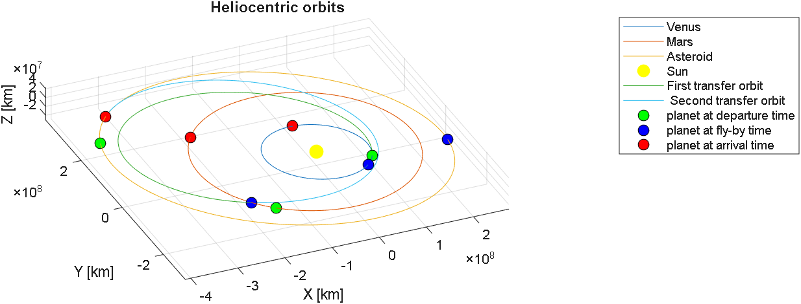
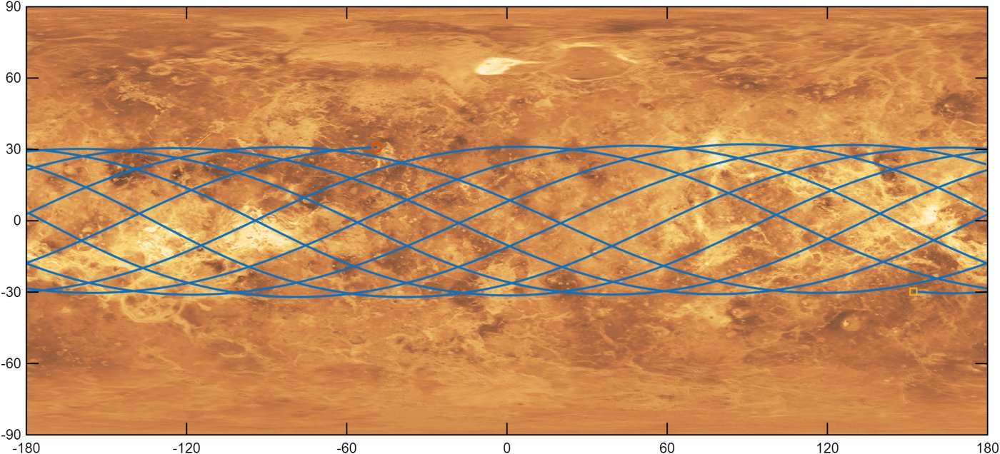
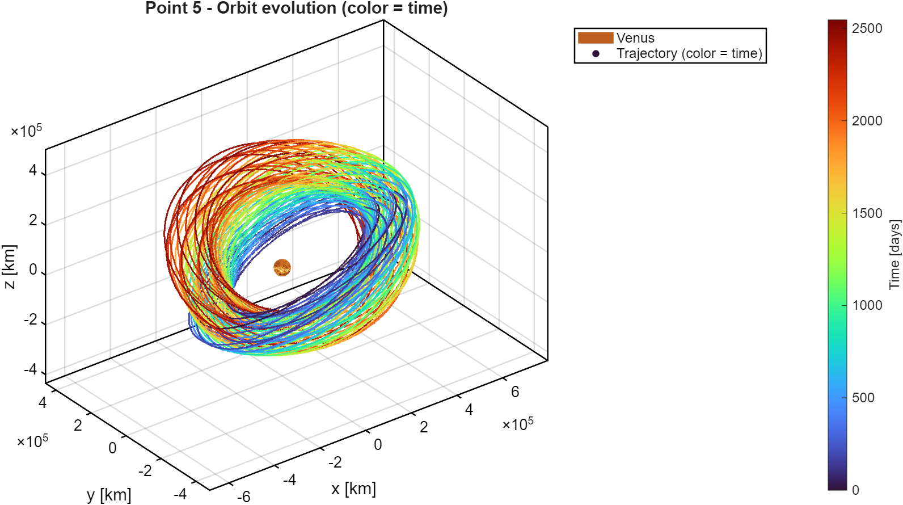
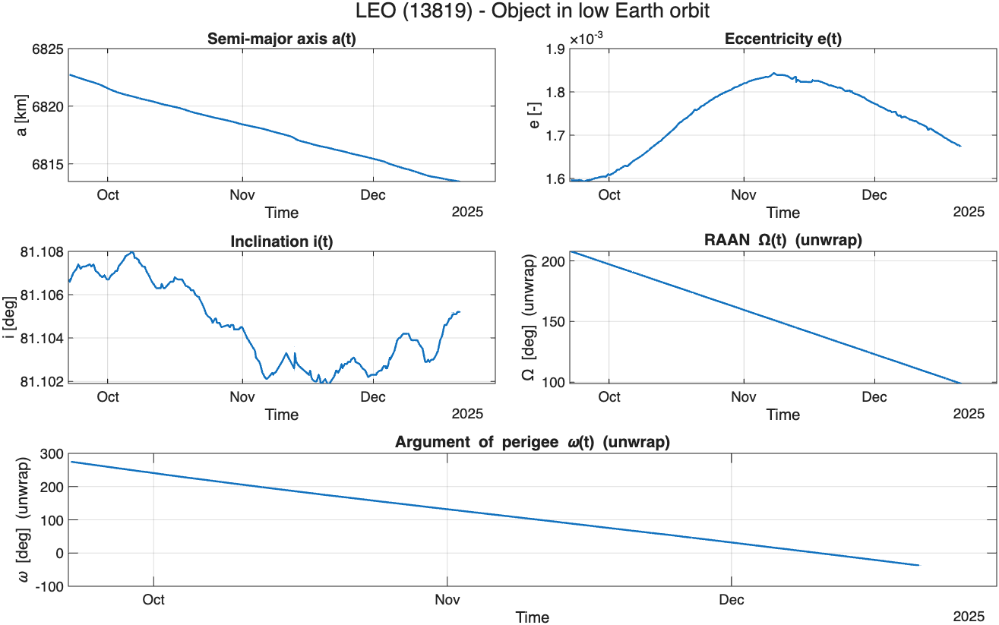

# Orbital Mechanics: Interplanetary Transfer Design and Perturbed Orbit Analysis (MATLAB)

Two mission-analysis studies in MATLAB:

1. **Interplanetary mission:** minimum-Δv design of a transfer from Venus to an asteroid, with a gravity assist at Mars.
2. **Planetary mission:** ground-track design and J2 + solar radiation pressure perturbation analysis of a satellite orbiting Venus, compared with real TLE data of two Earth-orbiting objects.

Group project for the *Orbital Mechanics* course, MSc in Space Engineering, Politecnico di Milano, A.Y. 2025/26.

## 1. Interplanetary mission: Venus → Mars fly-by → asteroid 184430

**Problem:** find the departure, fly-by and arrival dates between 2030 and 2060 that minimise the total Δv. The fly-by altitude must be at least 230 km, so that the spacecraft passes above the Martian exobase.

**Method**
- The total cost is Δv_tot = ΔV₁ (departure) + ΔV₂ (arrival) + Δv_p (powered manoeuvre at the fly-by pericentre). For each set of dates it is computed as follows:
  1. Planet and asteroid ephemerides give the departure, fly-by and arrival positions and velocities.
  2. Two Lambert arcs connect Venus to Mars and Mars to the asteroid.
  3. The incoming and outgoing hyperbolic excess velocities at Mars give the required turn angle.
  4. The pericentre radius is solved with `fzero` and checked against the minimum altitude.
  5. Δv_p is the impulse needed at that pericentre.
- **Search strategy:**
  1. A coarse 3-D grid search (20 points per date, Δv < 25 km/s threshold) narrows the 30-year window.
  2. A finer grid (30 points per date) provides the initial guess.
  3. `fmincon` (SQP) refines the solution.

**Result:** Δv_tot = **13.03 km/s**, with a time of flight of 3.28 years.

| Departure | Fly-by | Arrival | ΔV₁ | ΔV₂ | Δv_p |
|---|---|---|---|---|---|
| 27/05/2046 | 18/03/2048 | 04/09/2049 | 8.92 km/s | 4.11 km/s | 7.9·10⁻⁵ km/s |

The fly-by is almost unpowered:
- pericentre radius 6764 km (altitude 3374 km);
- turn angle 4.85°;
- Δv gained from the gravity assist: 1.01 km/s.



## 2. Planetary mission: perturbed orbit around Venus

**Nominal orbit:**
- Elements: a = 341 475 km, e = 0.0142, i = 149° (retrograde), Ω = 46°, ω = 94°, epoch 25/08/2045.
- Orbital period T ≈ 25.5 days.

**Ground tracks**
- The model accounts for Venus's retrograde rotation.
- Unperturbed tracks over 1 and 9 periods are confined to ±31° latitude, and shift by about 38° in longitude per orbit.
- **Repeating ground track:** with k/m = 30/1 the semi-major axis becomes a ≈ 159 150 km, and the track closes exactly after about 243 days in the unperturbed model.
- With J2 + SRP the same orbit drifts by about 3.5° per orbit (Δλ ≈ +105° after one cycle), so the orbit would have to be re-designed or maintained.

**Perturbed propagation (J2 + SRP)**
- SRP uses a cannonball model with C_r = 1 and A/M = 5.48 m²/kg. The Sun direction includes Venus's axial tilt.
- The orbit was propagated with two independent methods, both using `ode113` with 10⁻¹² tolerances:
  - Cartesian: direct integration of the equations of motion.
  - Gauss: Gauss planetary equations with the perturbing accelerations in the RSW frame.
- The two methods agree closely. Over 500 orbits, the relative error is about 10⁻³ on a and about 10⁻⁹ on e. The Cartesian method is slightly faster: about 3.1 s against 3.4 s.
- Moving-average filters (window = 1 orbital period, and window = 1 Venus year) separate the secular trends from the periodic ones:
  - a has a constant mean;
  - Ω grows steadily;
  - e, i, Ω and ω share a long-period oscillation of about 7500 days;
  - ω evolves in a "staircase" pattern, jumping whenever e approaches 0.





**Real data**
- Three months of TLEs (22 Sep – 20 Dec 2025) were analysed for two objects:
  - NORAD 13819 (SL-3 rocket body, LEO);
  - NORAD 8820 (LAGEOS-1, MEO).
- **SL-3 rocket body:** the semi-major axis decays by about 9 km because of atmospheric drag, and Ω and ω drift linearly because of J2.
- **LAGEOS-1:** the semi-major axis stays constant, and Ω drifts in the direction J2 predicts for a retrograde orbit.



The full method, validation and discussion are in the [project report](report/OrbitalMechanics_report.pdf).

## Repository structure

```
├── assignment1_interplanetary/
│   ├── InterplanetaryMission_group_2553.m   # main script, assignment 1
│   ├── functions/                           # Δv objective, Lambert/fly-by cost, conversions
│   └── data/2k_mars.jpg                     # Mars texture
├── assignment2_planetary/
│   ├── PlanetaryMission_group_2553.m        # main script, assignment 2
│   ├── functions/                           # perturbations, Gauss equations, ground tracks, TLE reader
│   └── data/2k_venus_surface.jpg            # Venus texture (TLE files go here, see below)
├── report/OrbitalMechanics_report.pdf
└── figures/                                 # images used in this README
```

## Requirements and setup

- **MATLAB.** Assignment 1 also needs the **Optimization Toolbox** (`fmincon`).
- **Course-provided functions.** These are not included because they were provided by the course teaching staff: `astroConstants`, `uplanet`, `ephAsteroids`, `lambertMR`, `date2mjd2000`, `mjd20002date`.
  - Put them, with any helper files they need, in a folder named `course_functions` next to the two assignment folders. Both scripts add that folder to the path automatically.
- **TLE data for assignment 2, part 7.** It is not included because the Space-Track user agreement does not allow redistributing the data.
  1. With a free [Space-Track.org](https://www.space-track.org) account, download the TLE history in 2-line format from 22 Sep 2025 to 21 Dec 2025 for NORAD IDs 13819 and 8820.
  2. Save the two files in `assignment2_planetary/data/`, with names starting with `LEO_13819` and `MEO_8820`. For example: `LEO_13819_20250922_20251221.tle.txt`.

## How to run

1. Open the main script of an assignment in MATLAB.
2. Press **Run**. If MATLAB asks, choose **Change Folder**, because the scripts must run from their own folder.

Each script prints the numerical results and opens all the figures.

## Authors

Simone Frescura, Nicola Pifano, Luca Puzzi, Lorenzo Veronese

Politecnico di Milano, *Orbital Mechanics*, A.Y. 2025/26

Planet textures: [Solar System Scope](https://www.solarsystemscope.com/textures/), licensed under [CC BY 4.0](https://creativecommons.org/licenses/by/4.0/).
